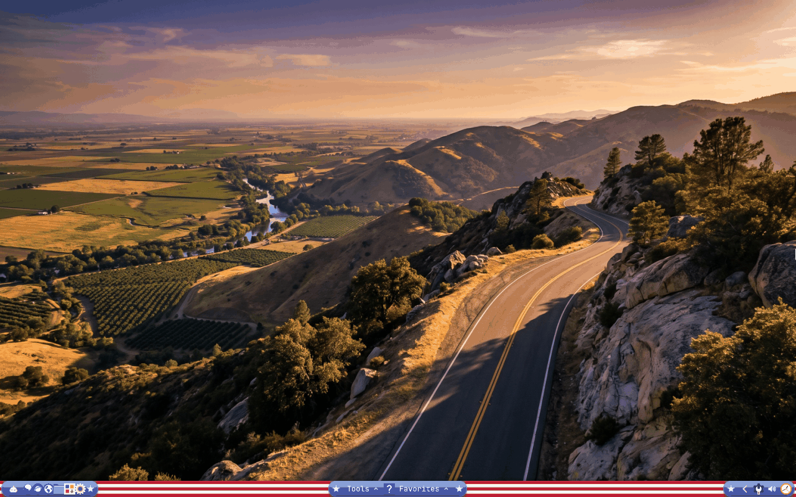
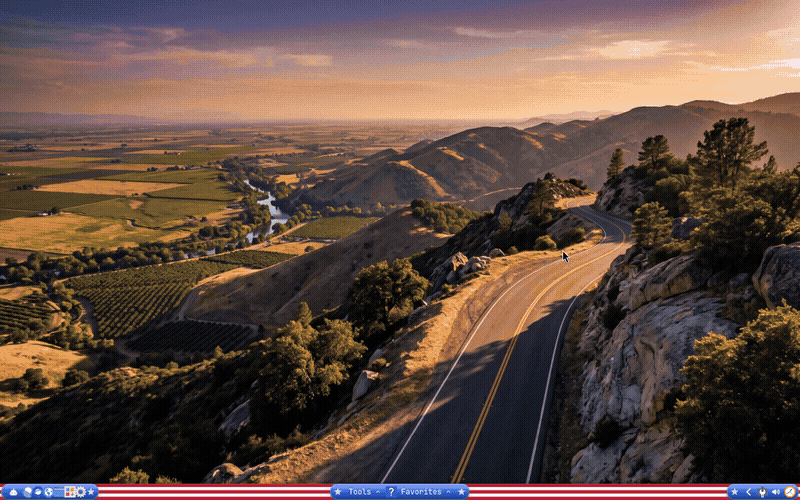

# Omnemo OS

Omarchy, made easy, made for memory.





*Both from a fresh Omarchy 4.5 install with nothing else changed. The wallpaper is the Hwy 180 one the edition adds.*

Omnemo OS is our edition of [Omarchy](https://github.com/omacom/omarchy): the same Omarchy underneath, a desktop that works the way people expect (a taskbar, plain-words buttons, a "?" guide to every icon, and the flag bar), made to run with [Omnemo](https://github.com/GuyMannDude/omnemo) memory, so the AI helpers on your computer remember you. It doesn't replace Omarchy: three lines you paste install it, and one command puts your computer back exactly as it was.

**Status: v0.9 Public Preview.** It runs on Omarchy 4.5 stable (out since 2026-11-05). It will be called 1.0 when it has come through a full Omarchy version update on a stock computer with the edition on. Expect rough edges, and tell us about them (see below).

**Your windows will float.** Stock Omarchy tiles: windows fill the screen side by side and you steer them from the keyboard. Omnemo OS switches that to windows that overlap, that you drag and resize with the mouse, with a taskbar to find them again. If tiling is why you chose Omarchy, this is the biggest change you will notice; Super + L (Super is the Windows key) switches a workspace between the two and back.

## Two ways to get it

1. **Just the memory.** Already on Omarchy and happy with it? Install [Omnemo](https://github.com/GuyMannDude/omnemo) on its own. Its guide shows you how to use it.
2. **The whole thing: Omnemo OS.** Install Omarchy from its own installer, then paste the three lines below. It sets up the friendlier desktop and [Omnemo](https://github.com/GuyMannDude/omnemo) memory together. If Omnemo is already on your computer, it is left exactly as it is.

## Install

This preview needs Omarchy 4.5 or newer. It never asks for your password, except Omarchy's own snapshot step.

1. Take a snapshot so you can undo: open a Terminal (Super + Enter) and type `omarchy snapshot create` (it asks for your password).
2. Paste the three lines below into the Terminal.

```
git clone https://github.com/GuyMannDude/omnemo-os
cd omnemo-os
bin/omnemo-os install
```

Omarchy 4.5 stable shipped on 2026-11-05; on an older 4.5 test version add `--allow-rc`.

**What it downloads, and how long it takes.** A bit under 200 MB in all: the memory program (about 130 MB) and the colored bar icons (about 35 MB), plus what they need. Once installed they take about 320 MB of disk. Before it changes anything, the installer says so. On a fast line the whole install took under a minute in our test; on a slow line or a small computer it has taken over ten. The memory step is the long one and prints nothing while it works. If you are offline, the desktop still installs (with one-color icons) and `omnemo-os repair` adds the rest later.

**Your AI helpers.** The memory is for AI helpers such as Claude or Codex, which need their own account with their maker. Install connects the memory to the helpers that are already on your computer and downloads none. A helper you start for the first time later (Omarchy downloads it then) gets the memory when you run `omnemo-os repair`. After installing, start a **new** session of your helper and it shares one memory with the others.

Afterwards, in any new Terminal:

- `omnemo-os status` shows what is installed (memory and icons included) and flags anything an Omarchy update reset.
- `omnemo-os repair` puts back what an update reset, and connects a newly arrived AI helper.
- `omnemo-os update` moves you to the newest version. It asks nothing and leaves your memories and your own settings alone.
- `omnemo-os uninstall` puts everything back exactly as it was.

You can delete the downloaded `omnemo-os` folder once it's installed. Want a new background? Tools → Theme & wallpaper now includes our own Hwy 180 at golden hour; your current wallpaper is never changed.

The flag on the bar moves: the stripes ripple like cloth, and it holds still by itself on battery, and on a computer with no graphics card (most virtual machines), where a moving flag would keep the processor busy. For a still flag, open `~/.config/omarchy/shell.toml`, find the line `# motion         = "off"` and delete the `#` at its start. If the bar is ever one plain colour with no flag, run `omarchy restart shell`.

Installed 0.9.2 or earlier? Those have no update command. Get the new copy and let it update yours: `git clone https://github.com/GuyMannDude/omnemo-os`, then `cd omnemo-os`, then `bin/omnemo-os update`. One thing an update cannot mend: what 0.9.2 itself did at install (it changed the AI helpers' settings files and downloaded Claude Code and Codex, about 840 MB) stays after a later uninstall, because the safety copies are only taken from 0.9.3 on.

### Before your next Omarchy update

Check one thing, once. Run `omnemo-os status`. If it prints a line that starts "BEFORE your next Omarchy update", run the command it shows (`sudo pacman -D --asexplicit omarchy`; it asks for your password) before you update. If it prints no such line, there is nothing to do.

Why: one step in the Omarchy 4.5.0 update removes a helper package along with anything that was installed only because of it, and on a few computers that took the desktop with it (black screen; [omarchy#18154](https://github.com/omacom/omarchy/issues/18154)). This is stock Omarchy, not the edition, and this section goes away once the fix lands.

### Your memories

Your memories are yours. Click **?** on the bar to see how many your AI helpers have saved. If memories from before are found when you install, you're asked "Keep them?", and uninstall asks "Keep your memories?" too. Pressing Enter always keeps them. Deleting takes typing the word DELETE, and a copy is saved first (`~/omnemo-memories-<date>.tar.gz`). Kept memories stay in `~/.local/share/omnemo`, and a later install picks them up where you left off.

## Share your ideas

Omnemo OS is brand new, and it's being shaped by the people who use it. You don't need to be a programmer to help. If something is confusing, annoying, or missing, we want to hear it.

- Tell us in plain words what you were trying to do and what got in the way. "I couldn't find how to change the wallpaper" is a perfect report.
- A phone photo of your screen is fine. No logs needed.
- Ideas are welcome too: a button you wish was on the bar, an app you'd like in Favorites, anything.

Problems or confusion: on the GitHub page click Issues → New issue → "Something went wrong (or confused me)". Ideas: click Discussions → Ideas. (You'll need a free GitHub account.) Or ask your AI assistant to write it up for you and paste it there. Every message gets read.

If something breaks badly, `omnemo-os uninstall` puts your desktop back exactly the way Omarchy had it.

## What's inside (you can skip this)

- `MANIFEST.md` — every file and setting the edition touches, as written on the test laptop.
- `INSTALLER-NOTES.md` — installer-side notes and the test gate. `SECURITY-REVIEW.md` — what the edition runs, reads, writes and downloads.
- `bin/omnemo-os` (`install` / `update` / `uninstall` / `status` / `repair`) — the edition layer; install copies it to `~/.local/share/omnemo-os/app` and links `~/.local/bin/omnemo-os` to it.
- `plugins/` — the edition's seven bar plugins, including the flag bar (`guy.flag`: blue behind the icons, rippling red and white stripes between them; its small graphics program ships as readable `flag.frag` beside the compiled `flag.frag.qsb`). `system/` — the one-bar guard (a 30-second timer that keeps exactly one bar running) `omnemo-window-minimize` (what Super + M runs), and `omnemo-icons-update`, which fetches the colored icons ([Papirus](https://github.com/PapirusDevelopmentTeam/papirus-icon-theme), GPL-3.0, downloaded from its makers, never bundled here). Run `omnemo-icons-update` any time for the newest set.

Omnemo OS is MIT licensed: see [LICENSE](LICENSE). Use it, change it, share it.

Omnemo OS is built on Omarchy (MIT license). "Omarchy" is a pending trademark of its owners. This project is not affiliated with or endorsed by them.
